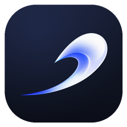
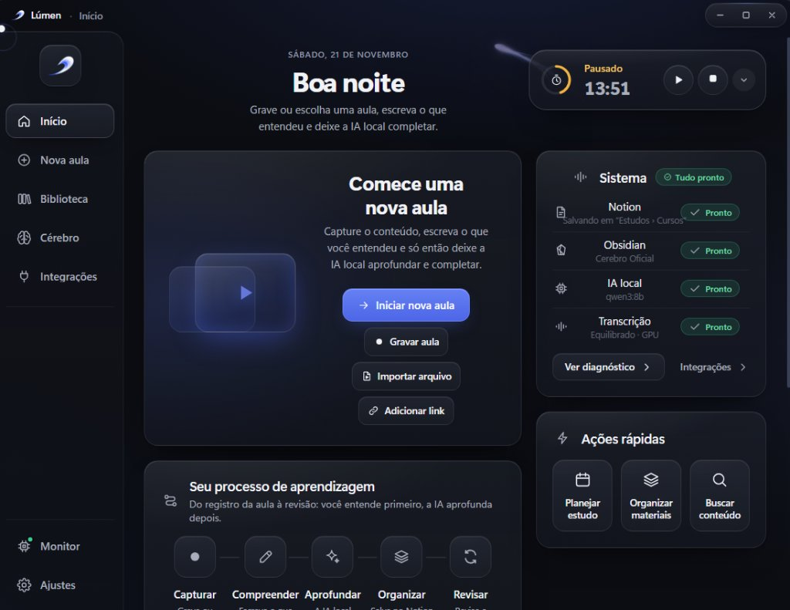

<div align="center">



# Lúmen

**A base local do seu segundo cérebro para estudar — transcrição, visão e IA 100% no seu PC.**

[](https://github.com/mrodriguesh/Lumen/releases/latest)
[-0078D4?style=flat-square&logo=windows&logoColor=white)](#requisitos)
[](#requisitos)
[](#modelos-locais-que-o-instalador-baixa)
[](#funcoes)

[**✨ Funções**](#funções) · [**💻 Requisitos**](#requisitos) · [**🚀 Instalar**](#instalar) · [**🎯 Como usar**](#como-usar) · [**📖 Manual**](docs/MANUAL.md) · [**🎨 Design**](docs/DESIGN.md) · [**🧭 Decisões**](docs/DECISOES.md)

</div>

---

O **Lúmen** é a base local de um **segundo cérebro** para estudar: transforma aulas (gravação do som do PC, arquivo de
vídeo/áudio ou capturas de tela) em material de estudo no **Notion** e no **Obsidian**, conversa com você sobre o que já
está na sua base e protege tudo com cópias criptografadas. A transcrição e a IA rodam **no seu PC** (Whisper/Parakeet e
Ollama): sem chave de API paga e sem enviar o áudio para a nuvem.

> [!IMPORTANT]
> **O Lúmen nunca cria a sua compreensão; ele complementa a que você construiu.** Antes de qualquer IA, você escreve o que
> entendeu da aula; só depois a IA local analisa a sua nota contra a aula.

<div align="center">
  
  <br>
  <sub><b>Tela de Início do Lúmen</b> — fluxo de aprendizagem, status do sistema local (Notion, Obsidian, IA local e Transcrição), ações rápidas e Pomodoro integrado.</sub>
</div>

> 📚 **Documentação do projeto:** Manual completo de cada tela e recurso: [docs/MANUAL.md](docs/MANUAL.md) · decisões técnicas: [docs/DECISOES.md](docs/DECISOES.md) ·
> design: [docs/DESIGN.md](docs/DESIGN.md) · teste de instalação em VM: [docs/TESTE-VM.md](docs/TESTE-VM.md)

<a id="funcoes"></a>
## ✨ Funções

- 🎙️ **Nova aula:** grava o som que sai do PC (com pausa), abre um arquivo de vídeo/áudio ou lê capturas de tela; transcreve
  no PC (Whisper na GPU NVIDIA ou Parakeet na CPU), com detecção de fala acelerada (2× e 4×).
- ✍️ **Minha compreensão:** você escreve o que entendeu (salvo a cada tecla, nas três janelas); a IA local analisa o que
  você acertou, o que faltou e o que confundiu — sem escrever por você.
- 📓 **Material salvo no Notion e/ou no Obsidian:** página da aula, mapa mental, Canvas, painel visual com as telas da aula,
  gráficos, capa (desenhada ou gerada por IA local) e visualização 3D; revisões espaçadas opcionais no Obsidian.
- 👁️ **Assistir a tela junto:** lê slides, quadro e código da tela com um modelo de visão local.
- 🎵 **Filtrar música externa:** protege a transcrição da música de fundo.
- 📚 **Biblioteca:** cursos, módulos, aulas avulsas, conteúdo gratuito, busca e filtros.
- 📌 **Barra flutuante:** gravar/pausar, nota da aula, conversa rápida e Pomodoro, sempre à mão na borda da tela.
- ⏱️ **Pomodoro** integrado (barra superior, barra flutuante e janela da nota).
- 🧠 **Estudos (Lúmen Study AI):** chat com a sua base (Notion, Obsidian, PDFs e pesquisa guiada no Edge), flashcards, quiz,
  mapas, diagramas e documentos em PDF, conversa por voz e treino falado (voz local do Voice Studio), modo escuta
  (chamada transcrita ao vivo no Notion e no Obsidian).
- 🔌 **Integrações:** Notion (API oficial), Obsidian, Google Drive (cópia da Proteção), Voice Studio, Open Notebook,
  HyperbookLM e o painel do Perplexity.
- 🛡️ **Proteção do cérebro:** cópias criptografadas e verificadas (restic) do Obsidian e do Notion, neste PC e no Google
  Drive, e o espelho Notion ↔ Obsidian.
- 🩺 **Diagnóstico do sistema:** 45 verificações (obrigatórias e opcionais) com reparo do que falta.
- 🔒 **Privacidade:** só IA local; tokens no Cofre de Credenciais do Windows; servidor só em `127.0.0.1` com token por sessão.

<a id="requisitos"></a>
## 💻 Requisitos

| Recurso | Especificação |
|---|---|
| 🪟 **Sistema** | **Windows 11** ou Windows 10 2004 (build 19041) ou mais novo, 64 bits. macOS e Linux: só pelo navegador, sem instalador e **não testado** (ver [Outros sistemas](#outros-sistemas)). |
| 🐍 **Python** | 3.14 (o instalador instala se faltar) |
| 🧠 **Memória (RAM)** | **16 GB recomendados** pelo projeto para o modelo de texto `qwen3:8b`. Medido: o Lúmen aberto, sem modelo carregado, ocupa ~0,6 GB (todos os processos); `qwen3:8b` carregado ocupa 5,59 GB e `qwen3.5:4b` 3,14 GB (Ollama, contexto de 4096). |
| 🎮 **Placa de vídeo** | Opcional. Com NVIDIA (CUDA 12), a transcrição e a IA usam a GPU; o Whisper `large-v3-turbo` usa ~2,25 GB de VRAM (medido numa RTX 3060 12 GB). Sem GPU, tudo roda na CPU. |
| 🌐 **Internet** | Na instalação (downloads abaixo) e para Notion, Google Drive e pesquisa na web. O resto funciona offline. |

### 💾 Espaço em disco

Medido neste projeto (GB = 10⁹ bytes). O instalador baixa tudo o que está marcado como padrão.

| Componente | Tamanho | Padrão? |
|---|---:|:---:|
| 📦 Programa do Lúmen (pacote do release: 0,015 GB) | 0,04 GB | sim |
| ⚡ Ambiente Python (`.venv`) com GPU NVIDIA (CUDA) | 2,55 GB | sim (com NVIDIA) |
| 💻 Ambiente Python (`.venv`) sem GPU | [medido no teste: ver docs/TESTE-VM.md] | sim (sem NVIDIA) |
| 🐍 Python 3.14 | 1,11 GB | se faltar |
| 🦙 Ollama (programa) | 3,36 GB | sim |
| 🧠 Modelos do Ollama (lista abaixo) | 15,74 GB | sim |
| 🎙️ Modelos de transcrição com GPU / sem GPU | 2,78 GB / 0,67 GB | sim |
| 🎵 Filtro de música (3 modelos) | 0,07 GB | sim |
| 🎨 Gerador de capas com IA | 6,79 GB | sim |
| 💎 Obsidian | 0,41 GB | sim |
| 🗣️ Voice Studio (programa) | 0,98 GB | sim |
| **Total com GPU NVIDIA** | **≈ 33,8 GB** | |

O Voice Studio baixa sozinho, na primeira abertura, o próprio ambiente e os modelos de voz do perfil escolhido nele (neste
PC: 10,17 GB de ambiente + 26,64 GB de modelos e dados); isso não entra no total acima. Os modelos ficam no seu perfil do
Windows (Ollama e Hugging Face) e o programa em `%LOCALAPPDATA%\Programs\Lumen`.

<a id="modelos-locais-que-o-instalador-baixa"></a>
### 🤖 Modelos locais que o instalador baixa

Sim: o comando de instalação baixa os modelos locais que o Lúmen usa. A lista vem do próprio código do Lúmen
(`installer/install.ps1` pergunta ao app quais usa); os tamanhos foram medidos no disco.

| Modelo | Para quê | Tamanho |
|---|---|---:|
| 🧠 `qwen3:8b` (Ollama) | material das aulas (modelo padrão) | 5,2 GB |
| 👁️ `qwen3.5:4b` (Ollama) | visão (telas) e chat dos Estudos | 3,3 GB |
| 🚀 `qwen3.5:9b` (Ollama) | esforço “Máximo” dos Estudos | 6,6 GB |
| 🔎 `qwen3-embedding:0.6b` (Ollama) | busca por significado | 0,64 GB |
| 🎙️ Whisper `large-v3-turbo` | transcrição (com GPU) | 1,62 GB |
| 🎧 Whisper `small` | conferência da voz e segunda opinião (com GPU) | 0,49 GB |
| 💬 Parakeet TDT 0.6B v3 (ONNX int8) | transcrição na CPU e conversa por voz | 0,67 GB |
| 🔊 Silero VAD | detecção de fala | 0,002 GB |
| 🎵 YAMNet, UVR-MDX-NET, WeSpeaker ResNet34 | filtro de música | 0,07 GB |
| 🎨 Z-Image-Turbo + stable-diffusion.cpp | capas geradas por IA | 6,79 GB |

Opcionais (só com `-Extras`): Whisper `large-v3` (“Maior precisão”, ≈ 3,1 GB segundo o projeto; não medido) com
`-Extras precisao`, e `qwen3.5-heretic:9b` (perfil adulto, 5,5 GB) com `-Extras adulto`.

<a id="instalar"></a>
## 🚀 Instalar

Há duas formas, que instalam a mesma coisa (o Lúmen, as dependências e os modelos locais) e podem ser repetidas para
reparar ou atualizar. Nenhuma pede administrador nem conta no GitHub. Escolha uma:

| | ⚡ Alternativa 1: comando no PowerShell | 📦 Alternativa 2: instalador do Windows |
|---|---|---|
| **Como** | uma linha no PowerShell | `Lumen-Setup-<versão>.exe`: escolha a unidade e clique em **Instalar** |
| **Versão** | sempre o último release | a versão do instalador baixado |
| **Unidade** | pergunta no terminal (ou `-Drive D`) | pergunta numa tela do assistente (ou `/DRIVE=D`) |
| **Opções** | `-Skip`, `-Extras`, `-InstallDir`… (tabela abaixo) | só a unidade: instala o resto sempre |
| **Desinstalar** | apagar a pasta do programa e os atalhos | **Configurações → Aplicativos → Lúmen → Desinstalar** |

### ⚡ Alternativa 1: comando no PowerShell

1. Abra o **PowerShell**.
2. Rode:

```powershell
irm https://github.com/mrodriguesh/Lumen/releases/latest/download/install.ps1 | iex
```

3. **Escolha a unidade** em que o Lúmen será instalado: o instalador lista os discos com o espaço livre e a pasta de cada
   um; digite o número (ou a letra) e aperte Enter (Enter sozinho = a unidade do Windows).
4. Acompanhe o progresso; no fim aparece um resumo `[OK]` / `[FALTA]` / `[MANUAL]` e o Lúmen abre.

### 📦 Alternativa 2: instalador do Windows (um botão)

1. Na página [Releases](https://github.com/mrodriguesh/Lumen/releases/latest), baixe `Lumen-Setup-<versão>.exe`.
2. Abra o arquivo. Se o Windows mostrar “O Windows protegeu o computador”, clique em **Mais informações → Executar
   assim mesmo** (o instalador não tem assinatura digital: [fill in: certificado de assinatura de código]).
3. **Escolha a unidade** em que o Lúmen será instalado (a do Windows vem marcada) e clique em **Avançar**. A tela seguinte
   mostra a pasta exata.
4. Clique em **Instalar**. Uma janela do PowerShell mostra o progresso dos downloads; ao terminar, clique em
   **Concluir** com “Abrir o Lúmen” marcado.

O instalador ([installer/setup/Lumen.iss](installer/setup/Lumen.iss), feito com o [Inno Setup 6](https://jrsoftware.org/isinfo.php))
leva dentro o pacote do Lúmen da sua versão e roda o mesmo `installer/install.ps1` da alternativa 1 (com `-Package`), que
baixa o resto. Cria os atalhos da Área de Trabalho e do Menu Iniciar e registra o desinstalador, que remove a pasta do
programa e os atalhos; seus dados e tokens (`%LOCALAPPDATA%\Lumen`), o Python, o Ollama e os modelos ficam. Instalação
silenciosa: `Lumen-Setup-<versão>.exe /VERYSILENT /DRIVE=D`.

Gerar o instalador (no Windows, a partir de uma cópia do repositório):

1. `winget install JRSoftware.InnoSetup`
2. `powershell -ExecutionPolicy Bypass -File installer\setup\build-setup.ps1 -Version <aaaa.mm.dd>`: gera
   `dist\Lumen-Setup-<versão>.exe` (e antes `dist\Lumen-<versão>.zip` com o `installer\publish-release.ps1`, se faltar).
   Com `-Publish`, anexa o `.exe` ao release `v<versão>` no GitHub (pelo `gh`).

### ⚙️ Como as duas funcionam

Instalação manual, a partir do código: `git clone https://github.com/mrodriguesh/Lumen.git`, depois `cd Lumen` e
`.\"Iniciar Lumen.bat"` (cria o `.venv`, instala o `requirements.txt` e abre o app; os modelos se baixam pelos Ajustes).

O [installer/install.ps1](installer/install.ps1) faz, em ordem: confere o Windows; busca o último release
pela API do GitHub e confere o SHA-256 do pacote (no instalador do Windows, confere o pacote que vem dentro dele);
instala com o **winget** o que faltar (Python 3.14, Visual C++, WebView2, Ollama, Obsidian); monta o ambiente Python
(com GPU NVIDIA, se houver); baixa os modelos e o Voice Studio; cria os atalhos; testa o servidor do Lúmen e abre o app.
O log fica em `%LOCALAPPDATA%\Lumen-Instalador\logs`.

Pode rodar de novo quando quiser (para reparar, atualizar ou reinstalar depois de desinstalar): o que já está pronto é
pulado, e sua configuração, histórico, notas e tokens (em `%LOCALAPPDATA%\Lumen`) nunca são tocados. A unidade só é
perguntada na primeira instalação (ou depois de desinstalar); uma instalação que já existe é mantida onde está.

**A unidade vale para o programa e o ambiente Python** (até ~2,6 GB; pede ≥ 5 GB livres). Na unidade do Windows a
pasta é `%LOCALAPPDATA%\Programs\Lumen`; nas outras, `<letra>:\Programas\Lumen`. Os modelos de IA (Ollama e Hugging
Face) e os dados do Lúmen continuam no perfil do Windows, a menos que você já tenha configurado `OLLAMA_MODELS` ou
`HF_HOME` para outro lugar.

Opções (troque `| iex` por `& ([scriptblock]::Create(...))` para passá-las; vários valores se separam por vírgula,
sem espaços):

```powershell
& ([scriptblock]::Create((irm https://github.com/mrodriguesh/Lumen/releases/latest/download/install.ps1))) -Drive D -Skip capas,obsidian
```

| Opção | Efeito |
|---|---|
| `-Skip gpu,ollama,fala,musica,capas,obsidian,voicestudio` | pula essas partes |
| `-Extras precisao,adulto` | baixa os modelos opcionais |
| `-Drive D` | instala na unidade D: sem perguntar (também vale `$env:LUMEN_INSTALL_DRIVE = 'D'`) |
| `-InstallDir D:\Programas\Lumen` | uma pasta qualquer, em vez da unidade |
| `-Package <zip>` | instala de um pacote já baixado (com o `SHA256SUMS.txt` ao lado) |
| `-NoShortcuts`, `-NoLaunch`, `-Force` | sem atalhos, sem abrir no fim, reinstalar os arquivos |

**Só você pode fazer** (são segredos ou escolhas suas): colar o token da integração do Notion, entrar na conta do Google
Drive, escolher o cofre do Obsidian e a pasta/chave da Proteção. Open Notebook, HyperbookLM (com a ponte do Lúmen) e o
ambiente do Chatterbox não têm origem registrada no projeto: [fill in: como instalar Open Notebook, HyperbookLM com a
ponte do Lúmen e o Chatterbox]; o instalador só confere se já existem.

<a id="outros-sistemas"></a>
### 🐧 Outros sistemas

O Lúmen roda no macOS e no Linux só pelo navegador, sem `Lumen.exe` e **sem teste** ([docs/MANUAL.md](docs/MANUAL.md#requisitos)).
Comandos do projeto, a partir de uma cópia do repositório: `python3 -m venv .venv`, `.venv/bin/pip install -r requirements.txt`
e `.venv/bin/python -m lumen`. [fill in: confirmar em macOS e Linux, que não foram testados]

<a id="como-usar"></a>
## 🎯 Como usar

1. 🚀 Abra o **Lúmen** pelo atalho da Área de Trabalho ou do Menu Iniciar. Na primeira vez, “Antes de começar” lista o que
   falta configurar.
2. 🔌 Em **Integrações**, conecte o Notion (token da integração em <https://www.notion.so/profile/integrations> e a página
   raiz) e/ou escolha o cofre do Obsidian.
3. 🎙️ Em **Nova aula**, escolha a fonte (gravar o som do PC, arquivo ou capturas) e clique em **Continuar**. Enquanto o Lúmen
   prepara a aula, escreva **Minha compreensão** e clique em **Processar minha compreensão** (Ctrl+Enter).
4. 📓 Leia a análise e clique em **Salvar no Notion** (ou no Obsidian). A aula fica na **Biblioteca**.
5. 📌 Use a **barra flutuante** na borda da tela para gravar, anotar e conversar; e **Estudos** para conversar com a sua base.
6. 🩺 Para conferir tudo: **Ajustes → Diagnóstico do sistema**.

Fechar a janela recolhe o Lúmen na bandeja; para sair, use **Sair do Lumen** na bandeja do Windows.

## 🗂️ Estrutura do repositório

```
lumen/        o app: servidor local em Python (lumen/web: a interface; lumen/study: os Estudos)
launcher/     Lumen.exe em C# (WebView2), bibliotecas do WebView2 e o restic (Proteção)
installer/    install.ps1 (instalador), publish-release.ps1 (gera o release) e setup/ (instalador do Windows: Lumen.iss, build-setup.ps1)
docs/         manual completo, decisões, design, recuperação da Proteção e o teste em VM
tests/        testes automáticos (unittest) e verificações de interface
bench/        benchmarks que escolheram os modelos e os resultados
requirements.txt, requirements-gpu.txt, requirements-bench.txt   dependências Python
Lumen.exe, Iniciar Lumen.bat                                       abrir e instalação manual a partir do repositório
```

## 🛠️ Desenvolvimento

- 🧪 **Testes:** `.venv\Scripts\python -m unittest discover -s tests -t .`
- 🔨 **Recompilar o `Lumen.exe`:** `powershell -ExecutionPolicy Bypass -File launcher\build.ps1`
- 📦 **Publicar uma versão:** `powershell -ExecutionPolicy Bypass -File installer\publish-release.ps1 -Version <aaaa.mm.dd> -Publish`
  (gera o zip, o `SHA256SUMS.txt` e o `constraints.txt` com as versões testadas, e cria o release com o `gh`).
